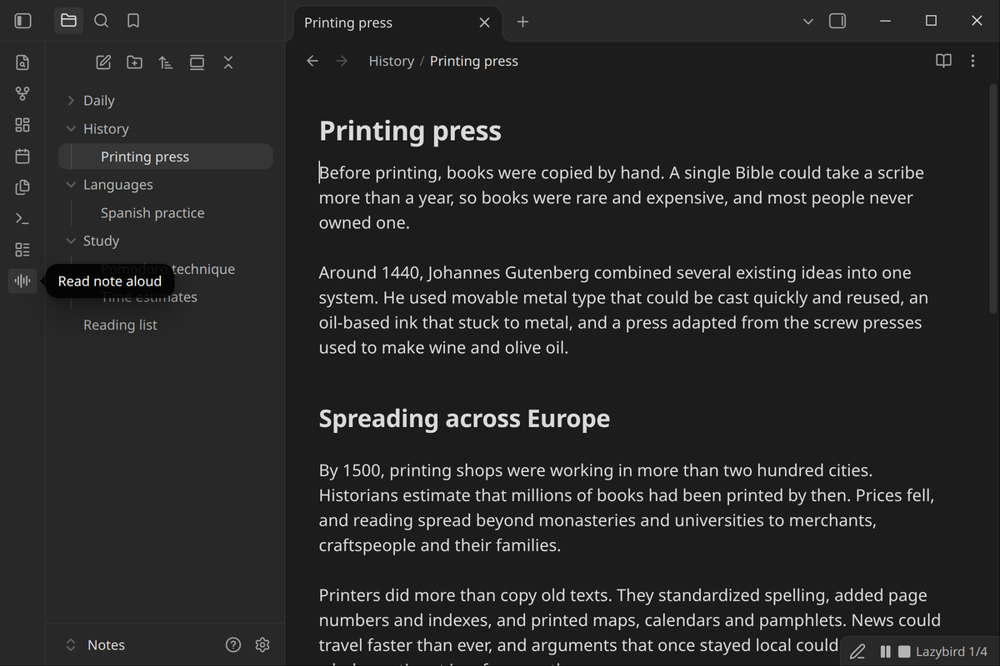
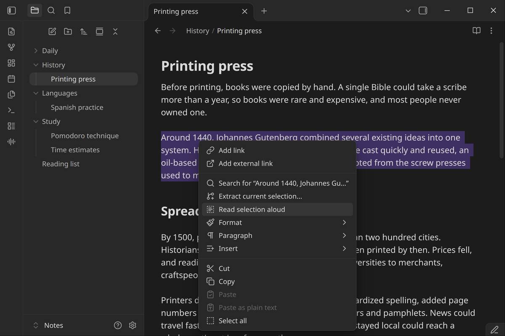
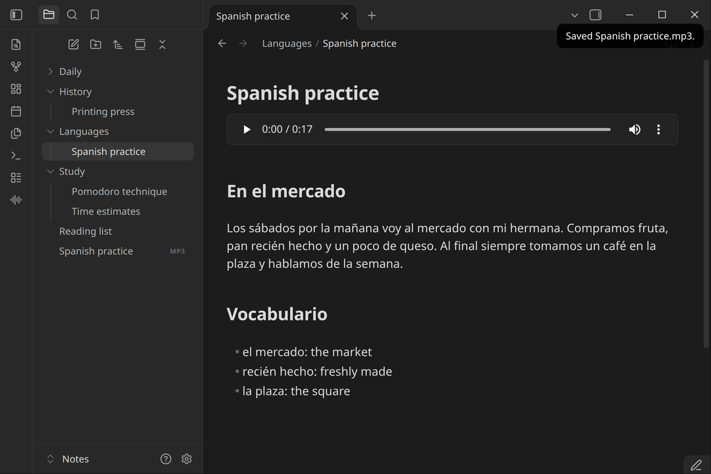
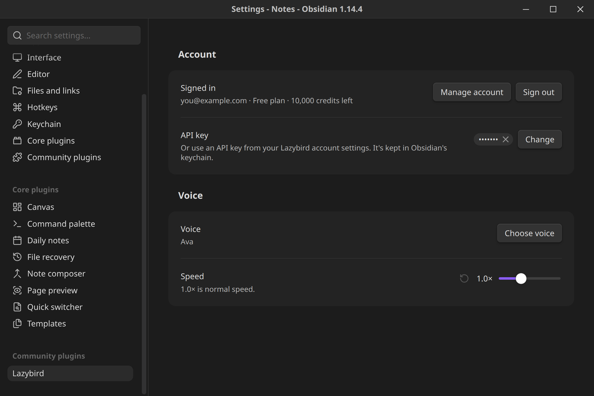
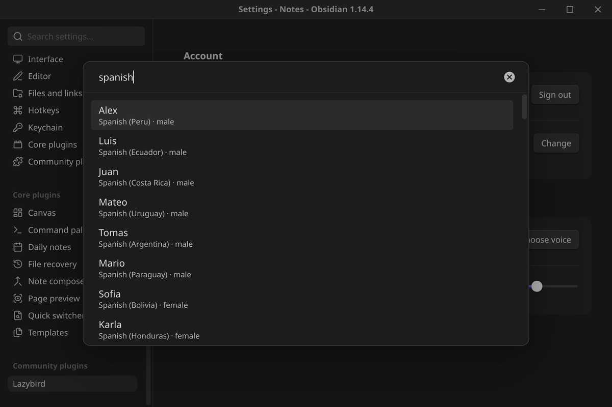

# Lazybird

Read your notes aloud and save them as MP3 files with natural AI voices. Works on desktop and mobile.



## Features

- **Read note aloud.** Select **Read note aloud** in the ribbon, choose **Read aloud** in the note's menu, or run the command. Playback starts within a few seconds, even for long notes, and keeps going while the rest is generated.
- **Read selection aloud.** Select text, right-click it and choose **Read selection aloud**.
- **Save note as MP3.** Choose **Save as MP3** in the note's menu. The audio is saved to your attachment folder, and an embed such as `![[My note.mp3]]` is added at the top of the note, below its properties.
- **Player controls.** Pause, resume or stop from the status bar on desktop, or from the floating player on mobile.
- **500+ voices in 80+ languages**, plus the voices you've made in your Lazybird account. Search voices by name or language. Speed from 0.5× to 2×.
- **Reads what matters.** Properties, code blocks, math, comments, HTML, URLs and embeds are skipped. Links are read as their text, and headings get a short pause.
- **Desktop and mobile.** On mobile, find **Read aloud** and **Save as MP3** in the note's **⋮** menu.





### On mobile

<p>


</p>

## Commands

- **Read note aloud**
- **Read selection aloud**
- **Save note as MP3**
- **Stop playback**

The commands have no default hotkeys. You can set them in **Settings → Hotkeys**.

## Setup

1. Install and enable the plugin, then open **Settings → Lazybird**.
2. Enter your email and select **Send code**. Type the 6-digit code from the email and select **Sign in**. If you don't have a Lazybird account yet, this creates a free one.

   Or, if you already have an API key, add it under **API key**. You can create one in your [Lazybird account settings](https://lazybird.app/studio/settings).
3. Select **Choose voice** to pick a voice, and set the speed.





## Account and payments

- **A Lazybird account is required.** The plugin turns text into speech on Lazybird's servers.
- **A free plan is available.** It includes a monthly allowance of characters. Each character you listen to or save uses one credit. The plugin's options show your plan and how many credits are left.
- **Paid plans are optional.** Reading and saving notes with the library voices works on the free plan. If you need more credits, see [lazybird.app/pricing](https://lazybird.app/pricing) for plans and extra credits.

## Network use and privacy

The plugin connects only to `api.lazybird.app`:

- To read or save a note, it sends the note's text (after removing the parts listed above), with the voice and speed you chose.
- To sign in, it sends your email and the code you enter.
- It loads the list of voices and your plan's remaining credits.

The plugin doesn't collect analytics. Audio for reading aloud stays in memory and is discarded when playback stops. Audio is saved to your vault only when you use **Save note as MP3**.

Your API key is stored in Obsidian's keychain, not in the plugin's data file. Obsidian encrypts it when your system provides a secret store. On systems without one, such as some Linux setups, Obsidian stores it unencrypted and shows a warning next to the key.

See Lazybird's [privacy policy](https://lazybird.app/privacy) and [terms](https://lazybird.app/terms).

## Requirements

- Obsidian 1.13.4 or later, on desktop or mobile.

## Development

```bash
npm install
npm run dev     # rebuild main.js on change
npm run build   # type-check and build
npm test        # unit tests for text cleanup, chunking and MP3 joining
npm run lint
```

To try it, copy `main.js`, `manifest.json` and `styles.css` into `<vault>/.obsidian/plugins/lazybird/`.

## License

[MIT](LICENSE)
